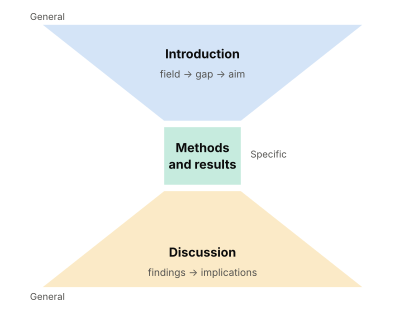

# Chapter 1. The architecture of a research article {#sec-cap1}

::: {.callout-note appearance="default"}
## Objectives
- Describe the IMRaD structure and the purpose of each section.
- Identify the rhetorical moves of introductions and abstracts.
- Plan a paper around one central contribution.
:::

::: {.callout-note appearance="simple" icon="false"}
## Chapter glossary
[IMRaD](92-glosario.qmd#gl-imrad) · [Rhetorical move](92-glosario.qmd#gl-move) · [CARS model](92-glosario.qmd#gl-cars) · [Research gap](92-glosario.qmd#gl-gap) · [Structured abstract](92-glosario.qmd#gl-abstract) · [Context-content-conclusion](92-glosario.qmd#gl-ccc)
:::

::: {.callout-tip appearance="simple" icon="false"}
## Downloads
[Assignment template (.qmd)](plantillas/entrega_reto.qmd){.btn .btn-outline-primary .btn-sm download="entrega_reto.qmd"}
:::

## Required reading

::: {.lectura}
Mensh, B.; Kording, K. (2017). [Ten simple rules for structuring papers](https://doi.org/10.1371/journal.pcbi.1005619). *PLOS Computational Biology*, 13(9), e1005619.
:::

## 1. One paper, one message

Mensh and Kording (2017) start with the most important rule: **focus your paper on a single central contribution**, which you can state in the title. Everything else serves that message. If you cannot write it in one sentence, the paper is not ready to be written.

They also recommend writing for the **naive human reader**: someone intelligent but outside your sub-field, who reads quickly and remembers little. Short sentences, defined terms and a logical flow help experts too.

## 2. IMRaD

| Section | Question it answers | Typical verb tense |
|---|---|---|
| **Introduction** | Why does this matter, what is unknown, what did you do? | Present (known facts), past (previous studies), present (aim) |
| **Methods** | How exactly did you do it? | Past, often passive or "we" |
| **Results** | What did you find? | Past |
| **Discussion** | What does it mean, how does it fit, what are the limits? | Present for interpretation, past for your findings |

Mensh and Kording suggest a **context-content-conclusion** scheme at every level: the paper, each section and each paragraph start by giving context, present the content and end with a conclusion. The first sentence of a paragraph should announce its message; the last should close it.

{#fig-e1-hourglass fig-alt="Hourglass diagram. The top is wide: the introduction moves from the general field to a specific gap and aim. The narrow middle contains methods and results. The bottom widens again: the discussion moves from the specific findings to their implications for the field."}

## 3. The introduction: Swales's CARS model

John Swales's analysis of introductions, the **CARS** model (*Create a Research Space*), describes three **rhetorical moves**:

1. **Establish a territory**: show that the topic is important and summarise what is known.
2. **Establish a niche**: show a **gap**, a problem, a contradiction or an unanswered question.
3. **Occupy the niche**: state your aim, what you did and (often) what you found.

Example:

> *Doctoral attrition rates exceed 30% in many countries* (territory). *However, most studies rely on cross-sectional surveys, and little is known about how supervision changes over time* (niche). *Here, we followed 1,200 doctoral students for five years to examine…* (occupy).

## 4. The abstract

Many journals ask for a **structured abstract** (Background, Methods, Results, Conclusions). Even when they do not, a good abstract follows the same moves in 150-250 words: context and gap, aim, methods, main results **with numbers**, and the main conclusion. Avoid references, undefined abbreviations and vague promises such as "results are discussed".

## Activities

::: {.ordenar #ia-e1-cars titulo="Put the introduction moves in order"}
1. Research on peer review has grown rapidly in the last decade
2. Several studies suggest that reviewers favour prestigious institutions
3. However, these studies are observational and cannot separate prestige from quality
4. Here, we report a randomised experiment in which author affiliations were hidden from half of the reviewers
5. We find that hiding affiliations reduced the acceptance advantage of prestigious institutions by half
:::

::: {.clasificar #ia-e1-section titulo="Which section does each sentence belong to?" categorias="Introduction|Methods|Results|Discussion"}
- "Little is known about how open data mandates affect data reuse." → Introduction
- "We downloaded all articles published between 2015 and 2024 from OpenAlex." → Methods
- "Reuse increased by 18 percentage points after the mandate." → Results
- "These findings suggest that mandates work best when combined with support." → Discussion
- "Participants were excluded if they had not completed the questionnaire." → Methods
- "Unlike previous studies, we found no effect of gender." → Discussion
:::

::: {.clasificar #ia-e1-move titulo="Which CARS move?" categorias="Establish a territory|Establish a niche|Occupy the niche"}
- "Reproducibility is a cornerstone of science." → Establish a territory
- "Yet no study has examined reproducibility in the humanities." → Establish a niche
- "In this paper, we audit 300 humanities articles." → Occupy the niche
- "Previous research has focused almost exclusively on psychology." → Establish a niche
:::

## Assignment {#reto-e1}

::: {.callout-important appearance="simple" icon="false"}
## Challenge for chapter 1 · Map and rewrite
1. Choose a recent article in your field and label every sentence of its introduction with a CARS move.
2. Write the **central contribution** of your current research in one sentence and turn it into a title.
3. Write a 200-word structured abstract for your research, with numbers in the results.

**Submission:** use the [assignment template](plantillas/entrega_reto.qmd). This challenge **has no solution in the book**.
:::

## Self-assessment

Answer all the questions and press **Show answers**. It does not count towards your grade.

::: {.webex-check .webex-box}
1. According to Mensh and Kording (2017), a paper should focus on 
2. In the CARS model, showing a gap in the literature is "establishing a "
3. The Methods section is usually written in the past tense. 
4. A good abstract should include the main results with numbers. 
5. The scheme recommended for papers, sections and paragraphs is context-content-
6. "Results are discussed" is an informative final sentence for an abstract. 
7. CARS stands for Create a Research 
8. Who is the "naive human reader"?


:::

::: {.webex-solution boton="Show explanations"}
- One message, stated in the title.
- Move 2.
- You report what you did.
- Concrete findings.
- At every level.
- It says nothing.
- John Swales.
- Writing for them helps everyone.
:::
